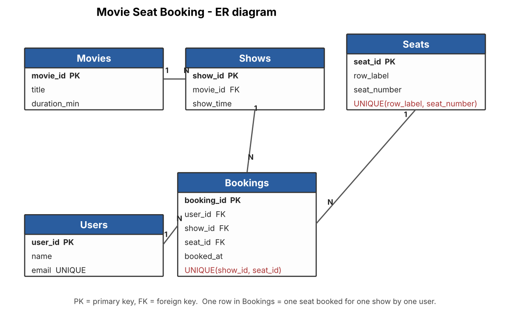

# Movie Seat Booking (DBMS project)

A small terminal app, built on Python + SQLite, that shows how **transactions, keys and
constraints** stop two people from booking the same seat.

**Standout demo:** two terminals try to book the same seat at the same moment.
With protection exactly one wins. Without protection both "win" (the bug).

## The problem

A cinema sells seats for shows. Two customers can click "book" for the same seat at
almost the same instant. If the program only checks "is it free?" and then saves, both
checks can pass before either save happens, and the seat is sold twice.
The database must make this impossible.

## ER diagram



Five tables: `Movies`, `Shows`, `Seats`, `Users`, `Bookings`.
`Bookings` has foreign keys to `Users`, `Shows` and `Seats`, and
`UNIQUE(show_id, seat_id)` so one seat can be saved only once per show.

## How to run

Needs Python 3.8+ only (SQLite is built in, nothing to install).
Run every command from the repo root.

```bash
python db/seed.py            # create movie.db with sample data (re-run to reset)
python app/cli.py            # the terminal menu
python tests/test_booking.py # basic tests (also works with: pytest tests)
```

### The race test (two terminals)

```bash
# WITH protection (transaction + UNIQUE)
python demo/race_test.py 1          # terminal 1
python demo/race_test.py 2          # terminal 2
python demo/race_test.py --reset    # free the seat before repeating

# WITHOUT protection (the bug)
python demo/race_no_protection.py 1     # terminal 1
python demo/race_no_protection.py 2     # terminal 2
python demo/race_no_protection.py --reset
```

Start the command in both terminals within the same 30 seconds. Both wait for the next
:00 or :30 on the clock and then fire together.
Shortcut for one terminal: add `--auto` (it starts both users itself).

| | With protection | Without protection |
|---|---|---|
| User 1 | OK | OK |
| User 2 | Seat already taken | OK |
| Rows saved for that seat | 1 | 2 (double booking) |

## What each file does

| File | Task | Purpose |
|---|---|---|
| `db/schema.sql` | MV1 | Five tables, keys, `UNIQUE(show_id, seat_id)` |
| `db/seed.py` | MV1 | Builds `movie.db`: 3 movies, 5 shows, 5x8 seats, 5 users |
| `docs/er_diagram.png` | MV1 | ER diagram |
| `src/db.py` | shared | `get_connection()` (foreign keys on, manual transactions) |
| `src/booking.py` | MV2 | `book_seat()` and `cancel_booking()` with BEGIN / COMMIT / ROLLBACK |
| `src/queries.py` | MV5 | `list_shows()`, `get_seat_map()`, `get_user_bookings()` |
| `app/cli.py` | MV4 | Menu, show picker, seat map (O free, X booked) |
| `demo/race_test.py` | MV3 | Race test with protection |
| `demo/race_no_protection.py` | MV3 | Same race without protection |
| `tests/test_booking.py` | MV6 | Basic tests incl. an end-to-end flow |
| `docs/viva.md` | MV6 | Ten likely viva questions with answers |

## Features covered (M1 to M7)

M1 five tables + ER diagram, M2 no double booking, M3 sample data, M4 show list and seat
map, M5 book a seat in a transaction, M6 cancel a booking, M7 my bookings.
